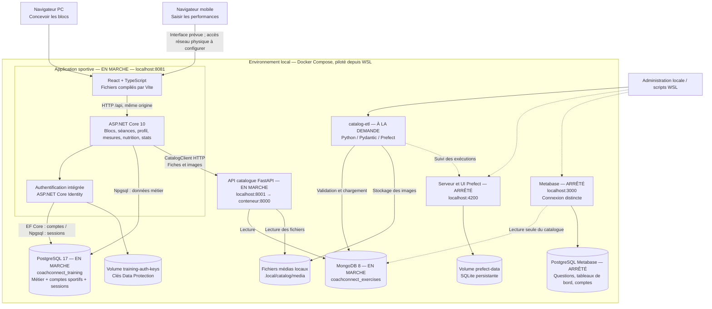
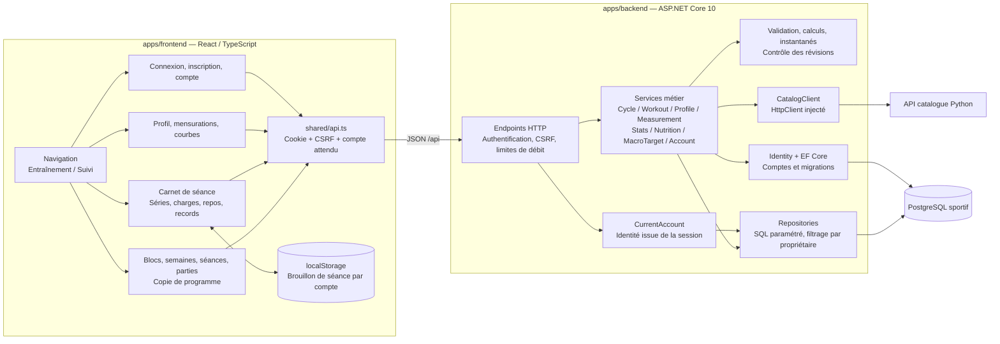
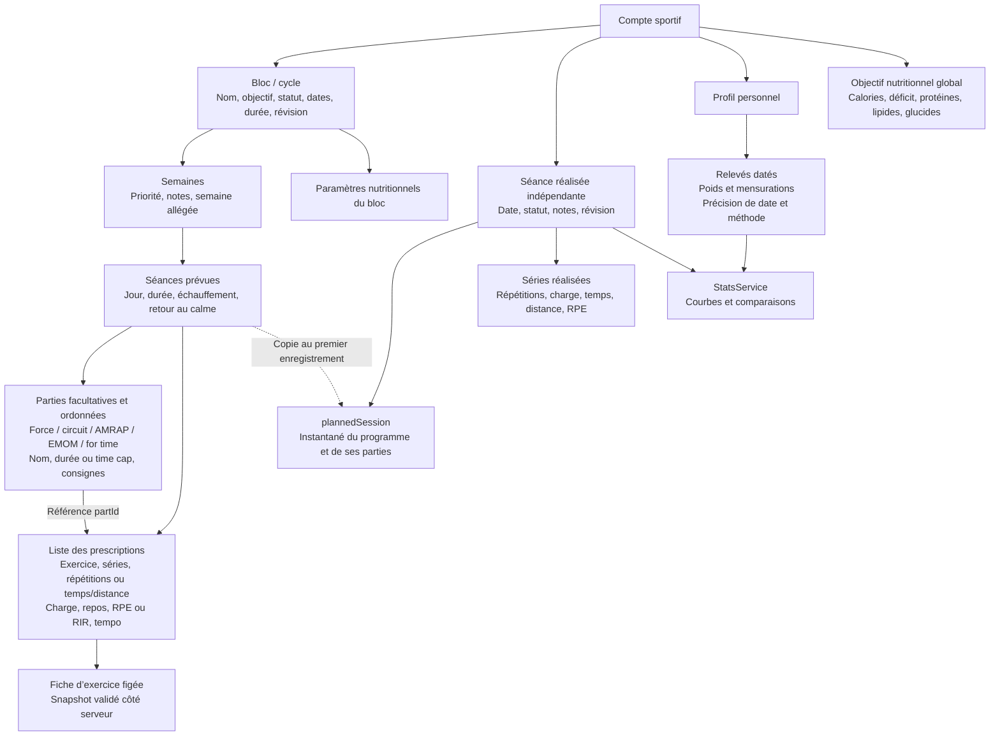
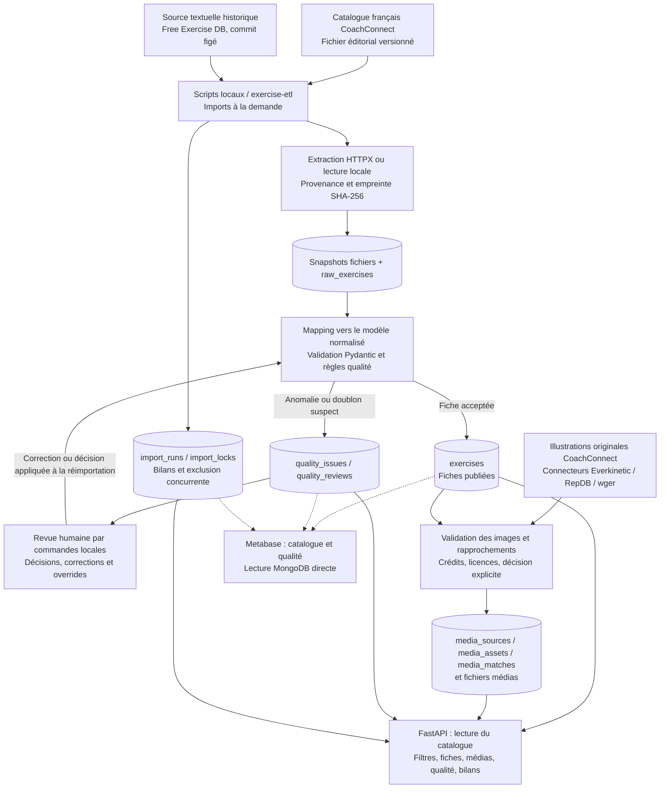
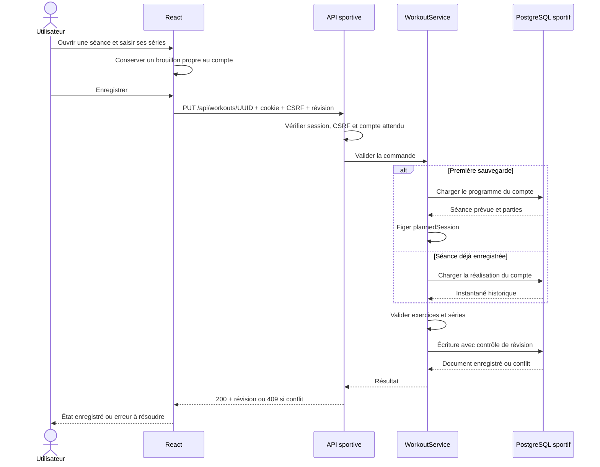

# CoachConnect — architecture actuelle

Relevé du **5 novembre 2026**, établi à partir du code, de `compose.yaml` et de l’état des conteneurs locaux. Les diagrammes décrivent l’existant. Après nettoyage, seuls les services utiles figurent dans le Compose principal. Prefect et Metabase sont conservés comme outils à la demande ; l’authentification est intégrée à l’application sportive.

La rubrique Nutrition et les estimations caloriques du profil ont été retirées de l’interface le 5 novembre 2026. Le code serveur et les données nutritionnelles historiques sont conservés pour compatibilité ; ils ne constituent plus une fonctionnalité exposée dans l’application.

Organisation du dépôt mise à jour le 10 novembre 2026 : `apps/` pour les applications, `infrastructure/` pour Docker et Metabase, `tests/` pour les scénarios transversaux. Le `compose.yaml` racine inclut la configuration d’infrastructure en conservant les volumes existants.

## 1. Vue d’ensemble et déploiement

Le cœur sportif est une application ASP.NET Core organisée par fonctionnalités, avec son front React livré dans le même conteneur. Le catalogue et les traitements de données constituent un service Python distinct. Les échanges applicatifs sont HTTP synchrones ; les imports sont des tâches lancées à la demande.

**Lecture des flèches :** une flèche décrit une dépendance ou un appel, pas nécessairement un processus actif. Les statuts sont ceux observés au moment du relevé. Les ports publiés sont liés à `127.0.0.1` : le navigateur mobile a été testé par émulation, mais un téléphone réel nécessite une configuration réseau et HTTPS adaptée.

## 2. Organisation interne de l’application sportive

- Le serveur sert aussi `index.html`, JavaScript et CSS compilés. Node sert à construire le front ; aucun serveur Node ne tourne dans le conteneur final.
- En développement, Vite peut servir le front séparément et rediriger `/api` vers `localhost:8081`.
- Les services sont injectés via DI. Les fonctionnalités métier utilisent principalement Npgsql ; EF Core est utilisé pour Identity.
- Les graphiques de la page **Stats** sont rendus dans React/SVG à partir de calculs .NET. Metabase concerne le catalogue, pas cette page.
- `X-Training-User` détecte un changement de compte entre onglets ; l’autorisation réelle provient de la session authentifiée, pas de cet en-tête.

## 3. Modèle des programmes et des performances

Ce diagramme représente les objets métier et leurs liens logiques, pas des tables SQL pour chaque niveau.

**Règles importantes :**

1. Les semaines, séances, parties et prescriptions sont stockées dans le document JSONB du bloc, et non dans une table chacune.
2. `session.exercises` reste la liste historique des prescriptions ; `session.parts` et `prescription.partId` ajoutent les séances composées sans casser les anciens blocs.
3. Une copie régénère les identifiants des séances, parties et prescriptions. La copie vers un autre bloc remplace le prévu du destinataire après confirmation et conserve ses dates et sa durée.
4. Modifier ou supprimer un bloc ne modifie pas les performances enregistrées. Leur instantané est conservé.
5. Les écritures métier concernées utilisent une révision : une modification concurrente obsolète est refusée avec HTTP 409.
6. Les statistiques exploitent les séances terminées et les relevés. Leur lecture utilise une transaction PostgreSQL `REPEATABLE READ` pour un ensemble cohérent.

## 4. Stockage réel

| Stockage | Contenu | Accès principal |
|---|---|---|
| PostgreSQL `coachconnect_training`, schéma `training_identity` | Utilisateurs, rôles et tables Identity | EF Core / Identity |
| `training_auth_sessions` | Sessions serveur chiffrées et révocables | Auth intégrée, Npgsql |
| `training_account_setup` | État de récupération locale des anciennes données | Auth intégrée |
| `training_cycles` | Métadonnées, propriétaire, révision, document JSONB du programme | CycleRepository |
| `training_workouts` | Référence du prévu, propriétaire, révision, instantané et résultats | CycleRepository / WorkoutService |
| `training_profiles` | Profil, propriétaire, révision, données personnelles | ProfileRepository |
| `training_body_measurements` | Historique des mesures associé aux révisions de profil | ProfileRepository |
| `training_measurement_entries` | Relevés de mensurations détaillés et datés | MeasurementRepository |
| `training_nutrition_settings` | Paramètres nutritionnels associés au cycle | NutritionRepository |
| `training_macro_targets` | Objectif de calories/macros propre au compte | MacroTargetRepository |
| MongoDB `coachconnect_exercises` | Catalogue, données brutes, qualité, imports, médias et provenance | Python ; Metabase en lecture seule |
| `.local/catalog/raw/` | Snapshots des sources importées | ETL |
| `.local/catalog/media/` | Images locales référencées par empreinte | ETL en écriture, API en lecture |
| Données embarquées Python | Catalogue français, illustrations originales, manifestes d’associations | Import éditorial et médias |
| Volume `prefect-data` | SQLite de suivi Prefect | Prefect |
| PostgreSQL Metabase | Comptes Metabase, connexions, questions, tableaux de bord | Metabase |

La base sportive est **relationnelle avec des documents JSONB**. MongoDB sert au catalogue. Le catalogue est partagé, tandis que les programmes, performances et mesures sont isolés par compte. Les anciennes données peuvent rester non attribuées jusqu’à leur récupération explicite à usage unique.

## 5. Catalogue, ETL et qualité

Le catalogue éditorial français et la source historique sont distingués par les filtres `curated` et `source`. Les connecteurs médias conservent leur propre provenance et licence. Les associations ne reposent pas uniquement sur un nom similaire : elles sont contrôlées et liées à une version du contenu. Aucun export massif des médias RepDB n’est prévu.

Les imports sont rejouables : identités stables et empreintes évitent la duplication. Les doublons suspects ne sont pas automatiquement fusionnés ; les nouvelles fiches invalides sont bloquées. Les corrections manuelles sont préservées. Un import peut charger une partie des fiches avant un échec ; son rejeu traite les éléments restants. Prefect suit les traitements, mais aucune planification récurrente n’est activée dans ce socle.

L’API Python est une API de lecture. Les écritures et décisions qualité passent par les commandes locales. Son port direct et l’interface Prefect ne sont pas raccordés à Identity ; ils restent exposés seulement sur la boucle locale dans la configuration actuelle.

## 6. Exemple : enregistrer une performance

Le premier PUT utilise un UUID généré côté client pour permettre le rejeu strict sans doublon. Le snapshot est pris lors de la **première sauvegarde côté serveur**, pas simplement à l’ouverture de l’écran. La consultation des performances existantes n’exige pas de recharger les fiches actuelles du catalogue ; le chargement d’une image reste tributaire du service médias.

## 7. Ports et état observé

| Service Compose | Port local → conteneur | État observé | Profil |
|---|---|---|---|
| `training-app` | 8081 → 8081 | En marche, sain | training |
| `training-db` | 55433 → 5432 | En marche, sain | training |
| `catalog-api` | 8001 → 8000 | En marche, sain | catalog |
| `catalog-mongo` | 57017 → 27017 | En marche, sain | catalog |
| `prefect` | 4200 → 4200 | Arrêté | catalog |
| `catalog-etl` | Aucun | Job à la demande, pas de conteneur permanent observé | etl |
| `metabase` | 3000 → 3000 | Arrêté | analytics |
| `metabase-db` | Non publié | Arrêté | analytics |

Metabase possède sa propre connexion et un utilisateur MongoDB en lecture seule. Son PostgreSQL stocke sa configuration, pas une copie du catalogue.

## 8. Livraison, persistance et limites actuelles

- Docker construit le front avec Node/Vite et le backend avec le SDK .NET. L’image finale est ASP.NET Core, exécutée avec un utilisateur non privilégié.
- Les données PostgreSQL, MongoDB, Prefect et les clés d’authentification sont persistées dans des volumes Docker ; les médias et snapshots bruts utilisent les répertoires locaux montés.
- Les secrets restent dans `.env`. Les sauvegardes privées et données locales restent dans `.local/`, hors versionnement.
- Une sauvegarde restaurable doit inclure les bases, les clés Data Protection, les médias et, pour Metabase, sa clé de chiffrement des connexions. Les seules bases ne suffisent pas à reconstituer toute l’installation.
- L’application comporte un brouillon local de séance ; elle ne fournit pas une synchronisation hors ligne complète.
- Aucun bus de messages, Redis, Kubernetes, fournisseur d’authentification cloud ou application mobile native n’est configuré dans cette architecture.
- Les services locaux disposent de healthchecks et de logs Docker. Prefect fournit le suivi des imports quand il est démarré ; aucune plateforme centralisée de traces n’est configurée dans Compose.
- Les contrôles existants couvrent compilation .NET/React, API authentifiée, isolation par compte, conflits, conservation des instantanés et parcours navigateur PC/mobile. Les tests d’écriture utilisent une base temporaire distincte.

## Sources dans le dépôt

- [Configuration et dépendances des conteneurs](../infrastructure/docker/compose.yaml)
- [Assemblage des services et routes sportives](../apps/backend/Program.cs)
- [Build de l’application](../apps/backend/Dockerfile)
- [Comptes intégrés](../apps/backend/Features/Accounts/)
- [Cycles et repositories](../apps/backend/Features/Blocks/)
- [Client catalogue](../apps/backend/Features/Catalog/CatalogClient.cs)
- [Fonctionnalités React](../apps/frontend/src/features/)
- [Catalogue, imports et qualité](../apps/exercise-catalog/README.md)
- [Configuration Metabase](../infrastructure/metabase/README.md)
- [Séances composées et copie des programmes](seances-composees.md)
- [Principes d’architecture](architecture.md)
